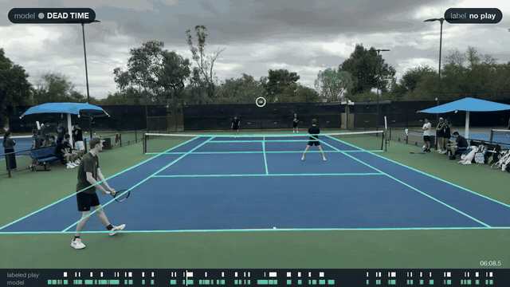
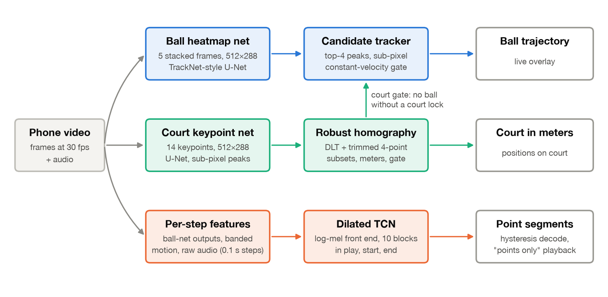
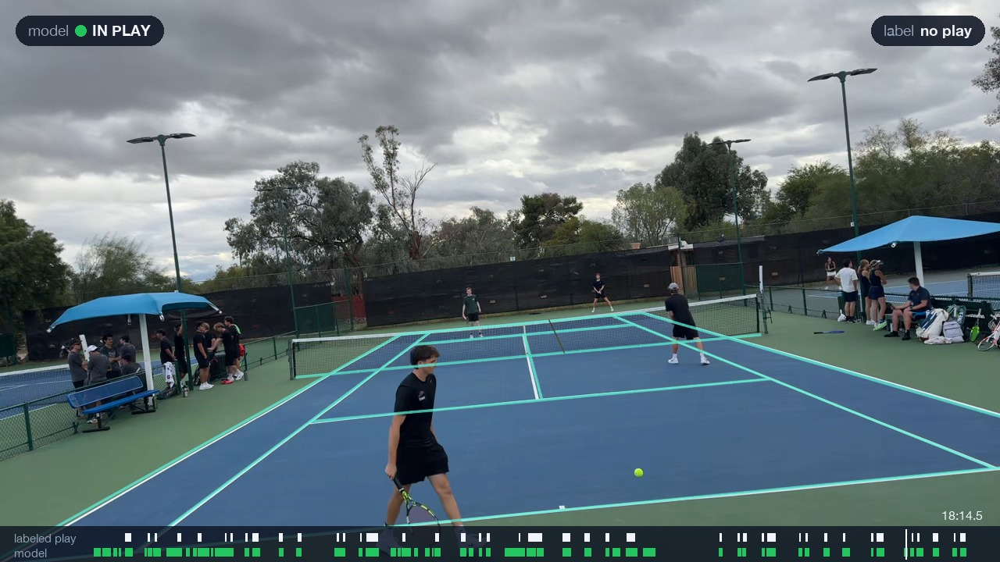
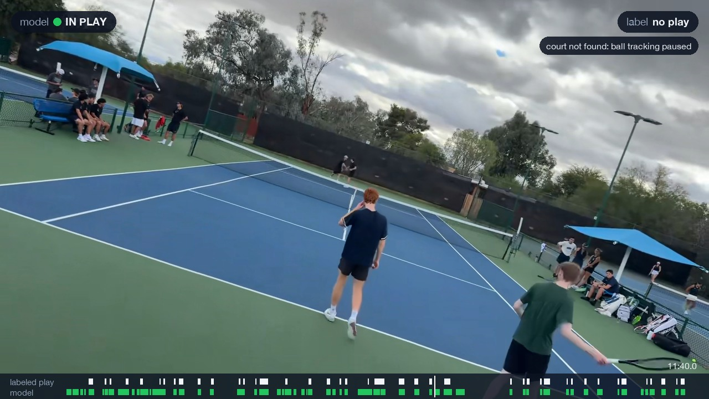
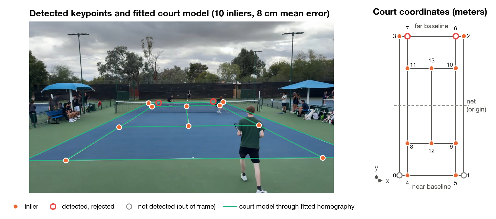
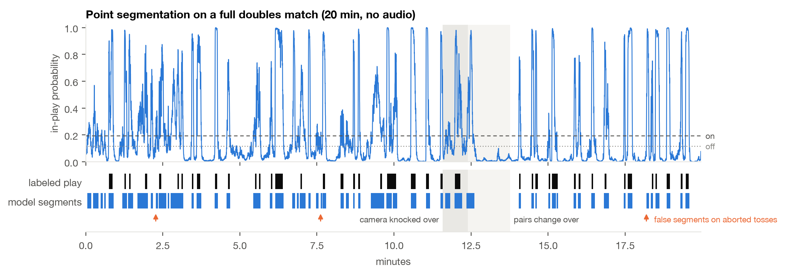

# Ball Tracking, Court Calibration and Point Segmentation for Amateur Tennis Video on a Phone

**Jacob Beal** · Break Point Technologies, LLC · November 2026

[**Technical report (PDF)**](report/report.pdf) · [**Research summary (PDF)**](report/summary.pdf) · [Authorship](docs/contributions.md) · [Results](docs/results.md) · [Methodology](docs/methodology.md) · [Claims and sources](docs/claims.md) · [Limitations](docs/limitations.md) · [Demo clips](assets/videos/)



*The shipped models on a college doubles match none of them had seen. Yellow: the tracked ball with a short trail. Teal: the court model projected through the fitted homography. Top left: the point segmenter's in-play decision. Top right: the label made afterward. Bottom: the full 20-minute timeline of labeled play vs. model segments. Full clips are in [`assets/videos/`](assets/videos/).*

> **Sole-author technical report, not peer reviewed.** Jacob Beal developed this work independently while building [MyBreakPoint](https://mybreakpoint.net). The contribution is the design, implementation, integration, and empirical study of an amateur-tennis vision system. See [author contributions](docs/contributions.md) and [data sources](docs/dataset_and_splits.md).

## Abstract

Phone recordings of club and college tennis are hard input for computer vision: off-center cameras, a ball a few pixels wide, every kind of lighting, and mostly dead time. This repository documents three on-device models and how they were evaluated: a TrackNet-style ball tracker with a candidate-level tracker, a court keypoint network with robust homography estimation, and a temporal convolutional network that finds the points in a full match.

- **Ball:** on 248 labeled frames from 7 test videos, the ball tracker is within 8 pixels (model resolution) on 87.9% of frames where the ball is visible.
- **Court:** a court model trained on broadcast footage reached 25.1% of frames within 15 cm on 10 amateur videos. Retraining on amateur frames raised that to 61.9% with temporal aggregation.
- **Points:** in 4-fold cross-validation over 42 labeled videos, the point segmenter keeps about 92% of labeled points whole while removing about half of the dead time, across three training seeds and with decode settings chosen without the scored fold.

The repository also documents:

- an early train/validation leakage problem and its fix;
- an evaluation bug found while preparing this write-up;
- selection bias in the original numbers;
- the experiments that did not help.

## The problems

Phone footage of club and college tennis is nothing like broadcast footage:

- The camera sits behind a fence or on a bench, often off center.
- The ball is a few pixels wide and blurs into a streak.
- Light ranges from midday sun to dim indoor halls and floodlit night courts.
- Most of a recording is dead time: walking, picking up balls, changeovers.

Three questions follow, each under a hard constraint: it all has to run on the phone, offline.

1. **Where is the ball?** Find it in each frame and follow it through blur, occlusion and look-alikes (shoes, line markings, balls on other courts).
2. **Where is the court?** Find the court in the image and map pixels to meters, so positions mean something on court.
3. **When is a point being played?** Find every point's start and end in a full match without cutting into any of them.

## What was built



| Problem | Approach | Code |
|---|---|---|
| Ball | TrackNet-style encoder-decoder over 5 stacked frames (512x288), Gaussian focal loss. Top local maxima refined to sub-pixel, then a constant-velocity tracker with confirmation and an adaptive gate chooses among them | `breakpoint_vision/models/tracknet.py`, `ball_track.py` |
| Court | U-Net keypoint network for 14 court points. Normalized DLT plus a robust trimmed and 4-point-subset fit to the ITF court model in meters, then a validation gate before any ball is trusted | `models/court_net.py`, `court.py`, `geometry.py`, `court_gate.py` |
| Points | Per-step features from the ball model and banded frame motion, raw audio through a log-mel front end inside the network, and a dilated temporal convolutional network (TCN) that predicts in play, point start and point end. Hysteresis decoding with a per-video threshold rescale | `points/features.py`, `points/model.py`, `points/decode.py` |
| Evaluation | Group-aware splits, 4-fold cross-validation stratified by lighting, system-level scoring that runs the full pipeline the way the app does | `data/split.py`, `scripts/`, `evaluation/` |

Details: [docs/methodology.md](docs/methodology.md).

## Results

The tables consolidate saved evaluation outputs and recomputations from predictions. Some historical observations are documented only. [docs/claims.md](docs/claims.md) traces each one to its source and says whether it reproduces.

| Task | Evaluation sample | Result |
|---|---|---|
| Ball tracking | 248 visible-ball frames from 7 test videos | **87.9%** within 8 px (82.3% within 3 px); 20 false alarms on 88 no-ball frames |
| Court calibration, broadcast-trained model | 359 frames, 10 amateur videos | **25.1%** within 15 cm (97.5% on broadcast frames) |
| Court calibration, amateur-trained model | same 359 validation frames, used for checkpoint selection | **61.9%** within 15 cm with temporal aggregation (53.5% single frame) |
| Point segmentation | 42 videos, 1,351 labeled serves, 4-fold CV | **91.9%** of points kept whole with held-fold decode re-selection (91.9% to 92.4% over three seeds; 94.2% with the original selection), 52.4% of dead time removed for seed 0 |
| All three, on a new match | 20 min college doubles, no audio | 42/42 serves kept whole, 54.6% of dead time removed, court locked 96% of the time |

How to read these:

- **Ball.** 8 px is measured at the model's 512x288 resolution, about 10 to 13 px in the 360p and 480p source video. The paired test compares 87.9% against the cached WASB-SBDT baseline (84.7%; frame-level McNemar p = 0.23). The separately decoded baseline scores 82.7%. These results establish neither superiority nor equivalence. The 87.9% measures the detector and tracker without the court gate; it is not whole-app accuracy.
- **Court.** The broadcast-trained model's 97.5% did not transfer to phone footage at all. Training on amateur frames fixed most of that, but 4 of the 10 videos still fail.
- **Points.** The original 94.2% chose decode settings on the same predictions it was scored on. Reselecting decoding settings without the scored fold gives 91.9%. This is a decode-selection sensitivity analysis, not fully nested model cross-validation; both results are reported.

Full tables, per-fold and per-video results, and the failed experiments: [docs/results.md](docs/results.md).

## Research contributions

1. An integrated pipeline combining multi-frame heatmaps, trajectory selection, court geometry, and multimodal temporal segmentation for amateur recordings.
2. An evaluation study that separates localization, calibration, and playback utility, with explicit denominators and failure cases.
3. Evidence of domain shift and compression sensitivity, plus an investigation of leakage, timestamp alignment, and decode-selection bias.

The work adapts established model families. It does not claim a new general-purpose architecture, state-of-the-art benchmark performance, or validated automated line calling.

## What worked and what didn't

Worked:

- **Reading the heatmap as a trajectory.** Taking candidates and running a tracker beat accepting each frame's argmax.
- **Measuring on reviewed labels**, not on agreement with a teacher model. The distilled student's numbers were all relative to its teacher, so it was never shown to beat the shipped model and wasn't shipped.
- **Extra weight on short segments.** It kept serve faults and unreturned serves from being cut. Without it, 92.9% of points were kept whole instead of 94.2%.
- **A per-video threshold rescale.** It handled videos where the model is under-confident: 90.7% kept whole without it.
- **Training the court model on amateur frames.** Amateur accuracy went from 25% to 54% single frame, and to 62% with aggregation.

Didn't work, or not clearly:

| Experiment | Result |
|---|---|
| Distilling the WASB model into a small student | Only teacher-relative results; never shown to beat the shipped model on the labels |
| Pooling both ball models with a Viterbi smoother | +3 points of recall for 2.4x to 2.9x the false alarms |
| Averaging two segmenters | Worse (92.5%) |
| Training the segmenter on heavily compressed copies | Worse (86.3% vs 94.7% on two folds) |
| A robustness fine-tune of the ball model on compressed video | Worse on the compressed test video it was checked on |
| Area vs bilinear resizing for the ball model | No consistent difference |
| Higher-resolution source video | No better than 360p/480p for the ball; for the court, one sharp view failed through the net mesh |

The biggest single lesson was about evaluation. The first ball and court accuracies (0.91 and 0.99) came from a random split over overlapping video windows, so they mostly measured memorization. Holding out whole clips and source videos gave lower numbers that meant something. See [docs/dataset_and_splits.md](docs/dataset_and_splits.md).

## Failure cases

| | |
|---|---|
|  |  |
| **False segment on an aborted serve.** The server tossed, stopped and caught the ball; the segmenter had already called it play ([clip](assets/videos/failure_aborted_toss.mp4)) | **Camera knocked over.** The court gate rejects the tilted view, so ball tracking pauses for 47 s; the segmenter keeps running and produces a false segment while players walk ([clip](assets/videos/failure_camera_tilt.mp4)) |

More in [docs/limitations.md](docs/limitations.md): small test sets, settings tuned on evaluation data, a single review pipeline for labels, leakage that remains in some splits, and few seeds.

## Figures





## Reproducing

```bash
python3.12 -m venv .venv && source .venv/bin/activate
pip install -r requirements.txt -r requirements-dev.txt && pip install -e .
python -m pytest
```

The tests exercise the public code on synthetic data. The footage, labels, trained weights and tuned operating values are not published:

- **Footage:** public YouTube videos I don't have redistribution rights to.
- **Labels:** tied to that footage.
- **Weights and tuned values:** the models ship in a commercial app.

So the reported numbers can be checked against the code and the result tables, but not rerun from scratch. [docs/reproducibility.md](docs/reproducibility.md) lists exactly what is withheld and how to run everything with your own data.

## Repository layout

```
breakpoint_vision/   models, tracker, court geometry, splits, training, point segmentation
scripts/             point segmenter feature building, cross-validation, decode selection
evaluation/          the scripts behind every reported number
configs/             training configs (tuned operating values are withheld)
results/             figures and result tables (anonymized video IDs)
assets/              demo clips and images from the author's own match
report/              technical report and research summary (Typst source and PDFs)
docs/                methodology, data and splits, results, claims, limitations, reproducibility
tests/               unit tests
```

To rebuild the PDFs and check the public tables and local document links, see [reproducibility.md](docs/reproducibility.md). The broader product and prototype scope is mapped in [system_scope.md](docs/system_scope.md).

## References

- Y.-C. Huang et al., "TrackNet: A Deep Learning Network for Tracking High-speed and Tiny Objects in Sports Applications," AVSS 2019.
- N.-E. Sun et al., "TrackNetV2: Efficient Shuttlecock Tracking Network," ICPAI 2020.
- S. Tarashima et al., "Widely Applicable Strong Baseline for Sports Ball Detection and Tracking," BMVC 2023 (WASB-SBDT).
- TennisCourtDetector, github.com/yastrebksv/TennisCourtDetector.
- C. Lea et al., "Temporal Convolutional Networks for Action Segmentation and Detection," CVPR 2017.

## Citation

```bibtex
@techreport{beal2026tennis,
  author      = {Beal, Jacob},
  title       = {Ball Tracking, Court Calibration and Point Segmentation for Amateur Tennis Video on a Phone},
  institution = {Break Point Technologies, LLC},
  type        = {Technical report},
  year        = {2026},
  month       = nov,
  note        = {Independent R\&D, not peer reviewed}
}
```

## License

Copyright © 2026 Break Point Technologies, LLC. All rights reserved.

This repository is published for reading and research evaluation only. It is not licensed for redistribution or reuse; see [LICENSE](LICENSE).
