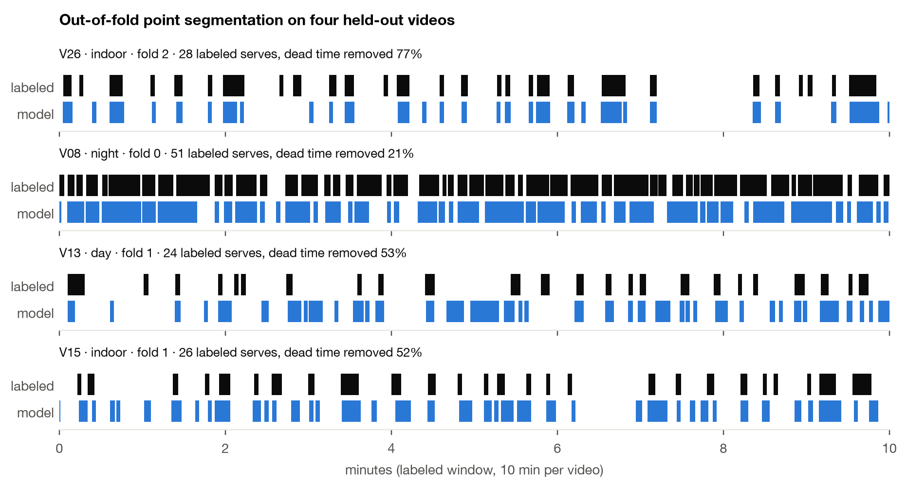
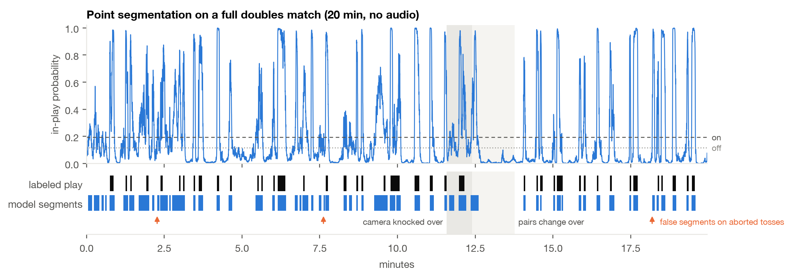

# Results

These tables consolidate saved evaluation outputs and recomputations; historical observations without recoverable outputs are labeled separately. [claims.md](claims.md) gives the source file, script and reproducibility status of each one. Video IDs are anonymized (`V01`, …).

## 1. Ball tracking

**Detector-plus-tracker score, without court gating,** on 350 labeled frames from 7 test videos (50 each). Of these, 248 frames have a visible ball, 88 have no ball in play and 14 are uncertain (excluded). The shipped 5-frame model and tracker run causally over the 1.5 s before each labeled frame.

| | Value |
|---|---|
| Visible ball within 8 px (512x288 model pixels) | **218 / 248 = 87.9%** |
| Visible ball within 3 px | 204 / 248 = 82.3% |
| No output on a visible frame | 23 / 248 |
| Output more than 8 px away | 7 / 248 |
| False alarms on no-ball frames | 20 / 88 |
| 95% Wilson interval for the 8 px rate | 83.3% to 91.4% |

The same number comes out of two independent paths:

- scoring the cached per-frame candidates
- re-decoding every video and running model and tracker end to end, after fixing a frame-timing bug described below

By lighting and by video (8 px, visible frames):

| Group | Within 8 px |
|---|---|
| Day (3 videos) | 105 / 112 = 93.8% |
| Dusk (1 video) | 27 / 35 = 77.1% |
| Night (3 videos) | 86 / 101 = 85.1% |
| Per video, lowest to highest | 77.1%, 79.4%, 83.9%, 89.7%, 91.7%, 92.7%, 97.6% |

Lighting groups are the tags used at evaluation time. One video tagged night looks like daylight, so treat the lighting split as rough.

**Comparison with the WASB-SBDT teacher**, run through the same tracker:

| System | Within 8 px | Within 3 px | False alarms |
|---|---|---|---|
| Shipped 5-frame model + tracker | 218 (87.9%) | 204 (82.3%) | 20 / 88 |
| WASB-SBDT teacher, cached candidates | 210 (84.7%) | 202 (81.5%) | 28 / 88 |
| WASB-SBDT teacher, end-to-end pipeline | 205 (82.7%) | 193 (77.8%) | 33 / 88 |

The shipped model is ahead on 21 frames and behind on 13 against the cached teacher (frame-level exact McNemar p = 0.23). Its observed hit count is higher and its false-alarm count lower on this sample. A nonsignificant test does not establish equivalence or noninferiority. Both this test and the Wilson interval treat frames as independent; within-video correlation makes them unsuitable as population-level uncertainty estimates. The paired test does not compare the 205-hit end-to-end teacher row.

**Pooling and smoothing** both models' candidates with a second-order Viterbi smoother reached 89.9% to 91.5% within 8 px, but with 33 to 58 false alarms instead of 20. Online pooling gave 89.5% at 37 false alarms. These grids were tuned on the same 350 frames, so the gains are optimistic, and the extra false alarms were not worth it.

**An evaluation bug found during this write-up.** Label times are stored rounded to the millisecond, and two evaluation scripts used a strict 0.1 ms comparison to find the labeled frame:

- One scored 67 visible frames one frame late. Its only saved log gave 82.7% overall, and the "88%" in the project notes was the day-only figure from that log.
- The other, used for the format experiments, scored 59 frames one frame early.

Both now match each label to the nearest decoded frame, and the format experiments below were rerun.

## 2. Court detection and calibration

Share of frames whose median court-plane error is within 15 cm. Frames with no homography count as failures.

| Model | Evaluation set | Within 15 cm | Median error |
|---|---|---|---|
| First model (broadcast-trained) | 200 broadcast frames | **97.5%** | 4.2 cm |
| First model | 359 amateur frames, 10 videos | **25.1%** | 604 cm |
| Current model (amateur-trained), single frame | same 359 frames | **53.5%** | |
| Current model, 12-frame running median (as the app runs it) | same 359 frames | **61.9%** | 12.2 cm |

- The broadcast-only model looked excellent on broadcast frames and failed on phone footage. Ball tracking depends on a court lock, so this was the main reason live tracking struggled.
- Training on amateur frames more than doubled the amateur score. Four of the ten amateur videos still fail completely.
- The amateur set was also used to pick checkpoints, so the current-model numbers are validation results.
- The broadcast set shares source videos with its training split (see [limitations.md](limitations.md)).
- On sharper 1080p footage, one view seen through the net mesh dropped from 88% to 32% within 15 cm. The model had only seen 480p training frames.

On the author's match the court locked on 96% of half-second samples, with a median of 10 inlier keypoints and a median reprojection error of 9.5 cm. It lost the court only while the phone was knocked over and tilted, for 47.5 s (see the demo).

## 3. Point segmentation

4-fold cross-validation over 42 labeled videos, folds stratified by lighting. Every video is scored by a model that never saw it. "Points" here means every labeled serve segment: 1,351 in total, counting points, faults and lets.

| | Points kept whole | Dead time removed |
|---|---|---|
| Original result (decode chosen on all out-of-fold predictions) | **94.2%** (1,272 / 1,351) | 50.4% (mean of videos) |
| Same, dead time weighted by time | | 58.7% |
| Nested: decode chosen on 3 folds, scored on the 4th | **91.9%** | 52.4% |
| Without 5 edited, near-continuous videos (978 points) | 92.2% | 57.2% |
| 95% bootstrap interval over videos (original) | 91.1% to 96.4% | 42% to 58% |

The row labeled nested reselects only the decoding and playback settings on existing out-of-fold predictions. It lowers retention by 2.3 percentage points, but it is not fully nested model cross-validation: models producing the selecting folds' predictions were trained using videos from the scored fold, and architecture and other design decisions remain selected on the full experiment. Treat 91.9% as a sensitivity analysis, not an unbiased estimate on unseen matches. A sealed match-level test set or fully nested retraining is still needed.

| Fold | Videos | Points | Kept whole | Dead time removed |
|---|---|---|---|---|
| 0 | 11 | 386 | 96.6% | 49.4% |
| 1 | 11 | 278 | 92.1% | 56.9% |
| 2 | 10 | 340 | 90.6% | 48.8% |
| 3 | 10 | 347 | 96.5% | 46.1% |

**Seeds.** The original runs all used seed 0. All four folds were retrained from scratch with seeds 1 and 2, with the same data, settings and decode:

| Seed | Kept whole (shipped decode) | Dead time removed, mean / time-weighted | Kept whole (nested) | Dead time removed (nested) |
|---|---|---|---|---|
| 0 | 94.2% | 50.4% / 58.7% | 91.9% | 52.4% |
| 1 | 94.2% | 48.4% / 56.3% | 92.4% | 50.5% |
| 2 | 93.9% | 48.1% / 56.1% | 92.0% | 51.2% |

- The shipped decode was chosen on seed 0's predictions, so the seed 1 and 2 rows in the first two columns also check that choice on predictions it never saw.
- Across seeds, kept whole moves by about half a point and dead time removed by about 2 points. That is smaller than the effect of selecting on the evaluation data (about 2 points) and well inside the bootstrap interval over videos.
- Three seeds is still few.

**What did not help**, all measured on the same folds:

| Change | Kept whole | Dead time removed | Note |
|---|---|---|---|
| No extra weight on short segments | 92.9% | | vs 94.2%; worst in indoor and dim indoor footage |
| Averaging two models | 92.5% | 53.7% | |
| No per-video threshold rescale | 90.7% | 55.0% | |
| Bilinear instead of area resize | -1.0 point | | fold 0 only |
| Training on heavily compressed copies | 86.3% vs 94.7% | 56.1% vs 53.1% | folds 0 and 1 only; run abandoned |

Example out-of-fold timelines, including a night video where little dead time is removed (`results/figures/cv_point_timelines.png`):

## 4. Format and quality robustness (ball tracking)

A separate on-device ONNX artifact, evaluated without court gating, on six of the test videos re-encoded from a higher-resolution source (217 visible frames). These runs use the fixed nearest-frame matching. Each variant was run once, with 29 to 42 visible frames per video. This artifact has a different SHA-256 from the artifact behind the headline ball result; their scores must not be conflated. The high-resolution sources include both 720p and 1080p.

| Variant | Within 8 px, bilinear resize | Within 8 px, area resize |
|---|---|---|
| Original 360p/480p | 192 (88.5%) | 192 (88.5%) |
| High-res source (720p/1080p) | 192 (88.5%) | 193 (88.9%) |
| 720p re-encode | 196 (90.3%) | 193 (88.9%) |
| Heavy compression (CRF 36) | **147 (67.7%)** | **138 (63.6%)** |
| 25 fps | 185 (85.3%) | 183 (84.3%) |
| Synthetic darkening | 176 (81.1%) | 181 (83.4%) |

- **Compression** is the one large, consistent effect: down 45 frames against the high-res source, worse on all six videos, mostly from missed detections.
- **Resolution:** no detectable effect.
- **Frame rate:** 25 fps is within noise at 8 px. It drops more at 3 px (184 to 149), partly because a 25 fps frame can sit up to 20 ms from the labeled moment.
- **Darkening** costs about 16 frames but unevenly: four videos got worse, two slightly better. It is synthetic darkening, not real low light.
- **Resize method:** no consistent difference.

Two conclusions from the original runs, that high-res footage tracked worse than the original and that 25 fps beat high-res, were artifacts of the frame-timing bug described above. Per-video numbers are in `results/tables/ball_formats.csv`.

## 5. A new match the models never saw

The author's own recording of a college doubles match: 20 minutes, 1280x720 at 60 fps, filmed from behind the near baseline. The audio track turned out to be silent. The private analysis harness ran the exported models on this recording. This is an integration demonstration, not a measured phone latency or numerical-parity benchmark. The match was labeled afterward from the frames alone, without looking at any model output: 42 serves (26 points, 15 faults, 1 let), about 3 minutes of play.

| | Value |
|---|---|
| Serves kept whole | **42 / 42** |
| Dead time removed | **54.6%** (time-weighted) |
| Video kept by the points-only plan | 644.6 s of 1,197.5 s |
| Predicted segments with no labeled play | 17 (92 s in total) |
| Court locked | 96.0% of samples |

- This demonstrates operation with silent audio on one match; it is not a controlled audio ablation or evidence that audio is unnecessary.
- Several false segments fire on aborted serves, where the server tosses, stops and catches the ball. The model sees a serve starting and can't know it was called off.
- Others come from the pre-match setup and the moment the knocked-over phone was set upright.
- The 40 seconds of empty court during the pair changeover produced no false segment.

One video can't estimate a rate, so this is a demonstration, not a benchmark.

## 5b. Leakage fix (documented, not reproduced)

Switching the ball and court splits from random samples to whole clips and source videos dropped held-out ball detection accuracy from 0.9067 to 0.812. The tolerance also changed (6/8 px to 4 px), so the two numbers are not directly comparable. The overlap figures (99.1% of validation ball windows one frame from a training window, and 99.8% of validation court frames sharing a source video with training) are recorded in the project notes, but their raw logs were not kept. See [dataset_and_splits.md](dataset_and_splits.md).
